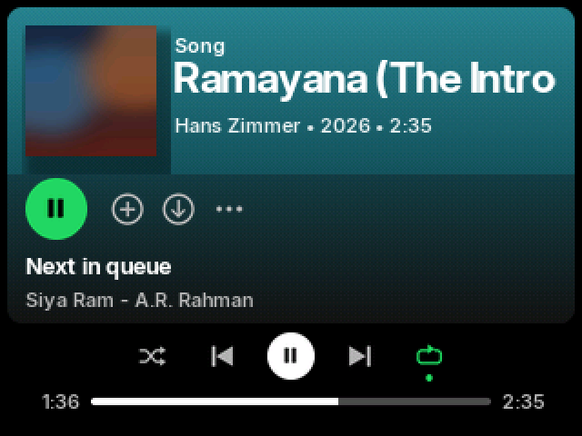
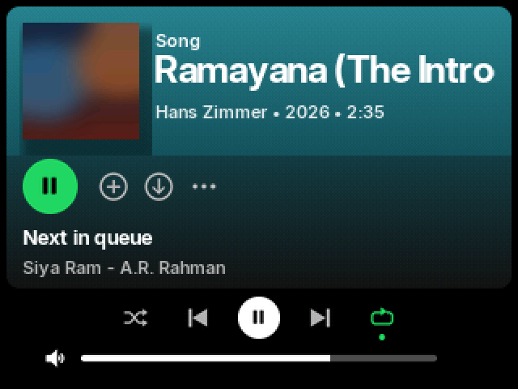
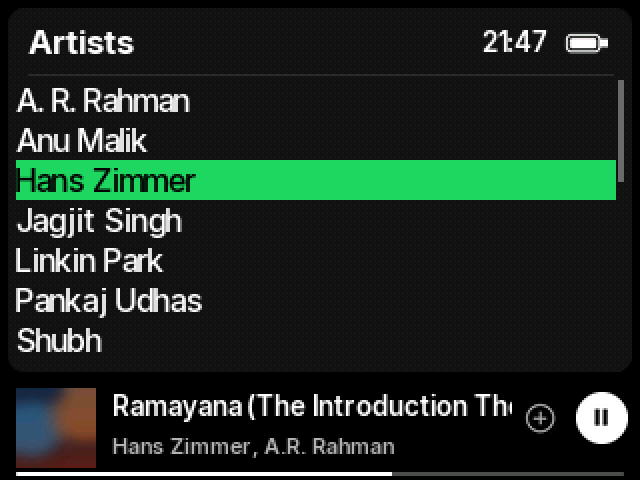

# Spotish — a Spotify-style Rockbox theme for the iPod Video

An unofficial theme for [Rockbox](https://www.rockbox.org) on the **iPod Video (5th / 5.5th gen, 320×240)**
that brings the look of the Spotify desktop player to your iPod: the "Song" card with big
album art and bold title, the green play button, a desktop-style player bar, and a
"Your Library" menu with a mini player. Optional Spotify-style **synced lyrics** included.

| Now Playing | Changing volume | Menus |
|---|---|---|
|  |  |  |

*Screenshots are exact renders of what the iPod draws (16-bit colour, Rockbox dithering and the bundled
fonts), made by the generator with a placeholder cover and sample track.*

## Features

- **Now Playing** — rounded "Song" card: album art, "Song" label, big bold title (scrolls when long),
  `artist • year • length`, green play/pause button, *Next in queue*.
- **Player bar** — shuffle, previous, white round play/pause, next, repeat. Shuffle and repeat turn green
  with Spotify's little dot when on; repeat-one shows a "1".
- **Progress** — elapsed time, thin white progress line, track length. Turning the click wheel swaps it
  for a volume line, which disappears 1.2 s after you stop.
- **Menus** — a "Your Library" card with a bold screen title, clock and battery, plus a black mini player
  (art, title, artist, play/pause, progress) under every menu.
- **Smooth scrolling** — long titles glide 1 pixel at a time.
- **Lyrics (optional)** — press the centre button on Now Playing to open synced lyrics: sung lines turn
  white, upcoming lines stay grey, with the mini player underneath. See [lyrics/](lyrics/).

## Compatibility

- Built and tested on an **iPod Video 5.5G** running Rockbox. It uses only standard skin tags, so other
  Rockbox builds for the iPod Video should work; other 320×240 colour targets (e.g. iPod Classic 6G) are
  likely to work but untested — reports welcome.
- Album art: Rockbox shows `cover.jpg` / `cover.bmp` (or embedded art, depending on your build).

## Install

1. Download `Spotish-vX.Y.zip` from the [Releases](https://github.com/stylo969/spotish-rockbox/releases) page.
2. Connect the iPod in disk mode and copy the zip's `.rockbox` folder onto the iPod's root, **merging** it
   with the existing `.rockbox` folder (it only adds files; fonts are prefixed `Spotish-` so nothing of
   yours is overwritten).
3. Eject the iPod, then on the iPod: **Settings → Theme Settings → Browse Theme Files → Spotish**.

The theme sets a few global settings when selected: font, colours, scrollbar, and smooth scrolling
(`scroll step: 1`, `scroll speed: 16`). Pick another theme to switch back.

## Lyrics (optional)

Rockbox's **lrcplayer** plugin shows synced `.lrc` lyrics; on the iPod Video, a short press of the centre
button on Now Playing opens it (if your hotkey setting is "Open plugin"). The [lyrics/](lyrics/) folder has:

- `lrcplayer.cfg` — Spotify-style lyrics settings (copy to `.rockbox/rocks/apps/`).
- `fetch_lyrics.py` — fetches synced lyrics for **your own** library from [LRCLIB](https://lrclib.net)
  (free, community-run) and lays them out where lrcplayer finds them. It sends song titles/artists to
  lrclib.net. No lyrics are distributed with this theme.

See [lyrics/README.md](lyrics/README.md) for details.

## Build from source

The theme is generated — every bitmap and the skin files come from one script, so graphics and
coordinates never drift apart. Edit `src/gen_spotish.py`, not the generated files.

```
pip install pillow numpy
python src/gen_spotish.py          # writes build/.rockbox and screenshots/
```

`src/rbdevice.py` emulates how Rockbox converts images on the iPod's RGB565 screen (it dithers only the
backdrop), so icons cut from the background match it exactly, and renders text with the real `.fnt` fonts
for the screenshots.

## Credits

- Fonts: [Inter](https://rsms.me/inter/) by Rasmus Andersson, SIL Open Font License 1.1 (`fonts/OFL.txt`),
  converted to Rockbox format with Rockbox's `convttf`.
- [Rockbox](https://www.rockbox.org) and its skin engine; lyrics via [LRCLIB](https://lrclib.net).
- Theme by [stylo969](https://github.com/stylo969).

## Disclaimer

Spotish is an unofficial fan theme. It is **not affiliated with, endorsed by, or connected to Spotify AB**.
"Spotify" is a trademark of Spotify AB. All artwork in this theme is original; no Spotify logos or assets
are used.

## Licence

- Theme files and artwork (`build/`, generated skins and images, screenshots): **CC BY-SA 4.0**
  ([LICENSE-CC-BY-SA-4.0.txt](LICENSE-CC-BY-SA-4.0.txt)).
- Scripts (`src/*.py`, `lyrics/*.py`): **MIT** ([LICENSE-MIT.txt](LICENSE-MIT.txt)).
- Fonts (`fonts/`, `src/fonts/`): **SIL Open Font License 1.1** ([fonts/OFL.txt](fonts/OFL.txt)).
