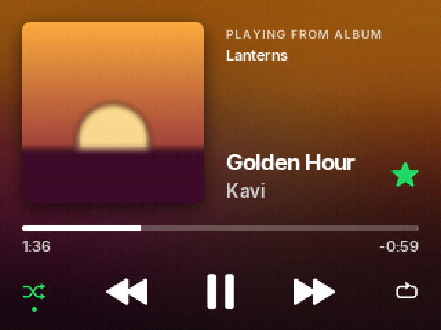
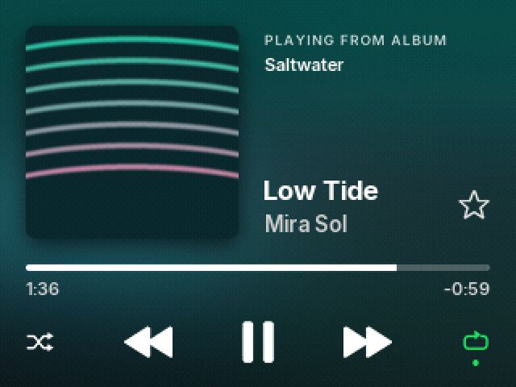

# Spotish — a Spotify-style Rockbox theme for the iPod Video

An unofficial theme for [Rockbox](https://www.rockbox.org) on the **iPod Video (5th / 5.5th gen, 320×240)**
that brings Spotify's look to your iPod: a **phone-style Now Playing screen that glows in each album's own
colours**, and a "Your Library" menu with a mini player. Optional Spotify-style **synced lyrics** included.

| Now Playing | Every album gets its own colours | |
|---|---|---|
|  |  |  |
| **Changing volume** | **Menus** | |
|  |  | |

*Screenshots are exact renders of what the iPod draws (16-bit colour, Rockbox dithering, alpha blending and
the bundled fonts), made by the generator with placeholder covers and sample tracks.*

## Features

- **Now Playing, phone style** — the whole screen is a soft, dark glow made from the album cover's own
  colours, with the rounded cover on top. Next to it: *PLAYING FROM ALBUM* and the album name, the big
  bold title (scrolls when long), the artist, and a star that turns green when the song is rated.
- **Album colours** — one small script (below) makes the glow for every album once; Rockbox then picks it
  up automatically. Songs without any art get a quiet grey version.
- **Controls** — shuffle, previous, play/pause, next, repeat in plain white. Shuffle and repeat turn green
  with Spotify's little dot when on; repeat-one shows a "1".
- **Progress** — thin full-width line with elapsed time on the left and time remaining on the right.
  Turning the click wheel moves the line to the volume and shows a speaker with the level, for 1.2 s
  after you stop.
- **Menus** — a "Your Library" card with a bold screen title, clock and battery, plus a black mini player
  (art, title, artist, play/pause, progress) under every menu.
- **Smooth scrolling** — long titles glide 1 pixel at a time.
- **Lyrics (optional)** — press the centre button on Now Playing to open synced lyrics: sung lines turn
  white, upcoming lines stay grey, with the mini player underneath. See [lyrics/](lyrics/).

## Compatibility

- Built and tested on an **iPod Video 5.5G** running Rockbox. It uses only standard skin tags, so other
  Rockbox builds for the iPod Video should work; other 320×240 colour targets (e.g. iPod Classic 6G) are
  likely to work but untested — reports welcome.
- Album art: Rockbox shows `cover.jpg` / `cover.bmp` (or embedded art, depending on your build).

## Install

1. Download `Spotish-vX.Y.zip` from the [Releases](https://github.com/owen-tariq/spotish-rockbox/releases) page.
2. Connect the iPod in disk mode and copy the zip's `.rockbox` folder onto the iPod's root, **merging** it
   with the existing `.rockbox` folder (it only adds files; fonts are prefixed `Spotish-` so nothing of
   yours is overwritten).
3. Make the album colours (next section) while the iPod is still connected.
4. Eject the iPod, then on the iPod: **Settings → Theme Settings → Browse Theme Files → Spotish**.

The theme sets a few global settings when selected: font, colours, scrollbar, smooth scrolling
(`scroll step: 1`, `scroll speed: 16`) and `album art: prefer image file` (so Rockbox uses the album
colour pictures before art embedded in songs). Pick another theme to switch back.

## Album colours (the glow behind Now Playing)

A Rockbox theme can't read colours out of album art by itself, so `make_backdrops.py` (in the zip, and in
[backdrops/](backdrops/)) does it once on your computer. For every album on the iPod it draws one
320×240 picture: a dark blur of the cover's colours, kept dark enough for white text, with the rounded
cover on top. It saves it next to the music as `cover.320x240.bmp`. Rockbox looks for a cover made for
the exact size a theme asks for before the normal one, so Spotish finds these by itself.

```
pip install pillow mutagen
python make_backdrops.py              # finds the iPod by itself
python make_backdrops.py E:\          # or say where it is (Windows drive / /Volumes/IPOD on a Mac)
```

- Run it again after adding music: albums that are already done are skipped, so it's quick.
- It reads `cover.jpg`, `folder.jpg`, track-named images, the parent folder's cover (multi-disc albums)
  and, with `mutagen`, art embedded in the songs. A folder of singles with different art gets one
  picture per song.
- It never changes your own covers or music. `--dry-run` shows what it would do; `--remove` deletes exactly
  the files it made (it keeps a list in `.rockbox/spotish-backdrops.txt`); `--force` remakes them all.
- Each picture is about 225 KB (1,000 albums ≈ 225 MB).
- An album the script hasn't seen yet shows its normal cover stretched over the screen until you run it.

## Lyrics (optional)

Rockbox's **lrcplayer** plugin shows synced `.lrc` lyrics; on the iPod Video, a short press of the centre
button on Now Playing opens it (if your hotkey setting is "Open plugin"). The [lyrics/](lyrics/) folder has:

- `lrcplayer.cfg` — Spotify-style lyrics settings (copy to `.rockbox/rocks/apps/`).
- `fetch_lyrics.py` — fetches synced lyrics for **your own** library from [LRCLIB](https://lrclib.net)
  (free, community-run) and lays them out where lrcplayer finds them. It sends song titles/artists to
  lrclib.net. No lyrics are distributed with this theme.

See [lyrics/README.md](lyrics/README.md) for details.

## Build from source

The theme is generated — every bitmap and the skin files come from one script, so graphics and
coordinates never drift apart. Edit `src/gen_spotish.py`, not the generated files.

```
pip install pillow numpy
python src/gen_spotish.py          # writes build/.rockbox and screenshots/
```

`src/rbdevice.py` emulates how Rockbox converts images on the iPod's RGB565 screen (it dithers only the
backdrop and album art) and how it blends 32-bit alpha images, and renders text with the real `.fnt`
fonts for the screenshots. The album glow itself lives in `backdrops/make_backdrops.py`, which the
generator imports, so the cover position in the pictures and in the skin always match.

How Now Playing works: the album picture is drawn with `%Cl(0,0,320,240)` inside a `%VB` viewport, which
draws into the backdrop buffer rather than the screen. Rockbox clears every text line to the backdrop
before drawing it, so the title, artist and times sit on the glow instead of on solid boxes, and the
icons are 32-bit BMPs with alpha that blend with it.

## Credits

- Fonts: [Inter](https://rsms.me/inter/) by Rasmus Andersson, SIL Open Font License 1.1 (`fonts/OFL.txt`),
  converted to Rockbox format with Rockbox's `convttf`.
- [Rockbox](https://www.rockbox.org) and its skin engine; lyrics via [LRCLIB](https://lrclib.net).
- Theme by [stylo969](https://github.com/stylo969); phone-style Now Playing and album colours by
  [owen-tariq](https://github.com/owen-tariq).

## Disclaimer

Spotish is an unofficial fan theme. It is **not affiliated with, endorsed by, or connected to Spotify AB**.
"Spotify" is a trademark of Spotify AB. All artwork in this theme is original; no Spotify logos or assets
are used.

## Licence

- Theme files and artwork (`build/`, generated skins and images, screenshots): **CC BY-SA 4.0**
  ([LICENSE-CC-BY-SA-4.0.txt](LICENSE-CC-BY-SA-4.0.txt)).
- Scripts (`src/*.py`, `lyrics/*.py`, `backdrops/*.py`): **MIT** ([LICENSE-MIT.txt](LICENSE-MIT.txt)).
- Fonts (`fonts/`, `src/fonts/`): **SIL Open Font License 1.1** ([fonts/OFL.txt](fonts/OFL.txt)).
